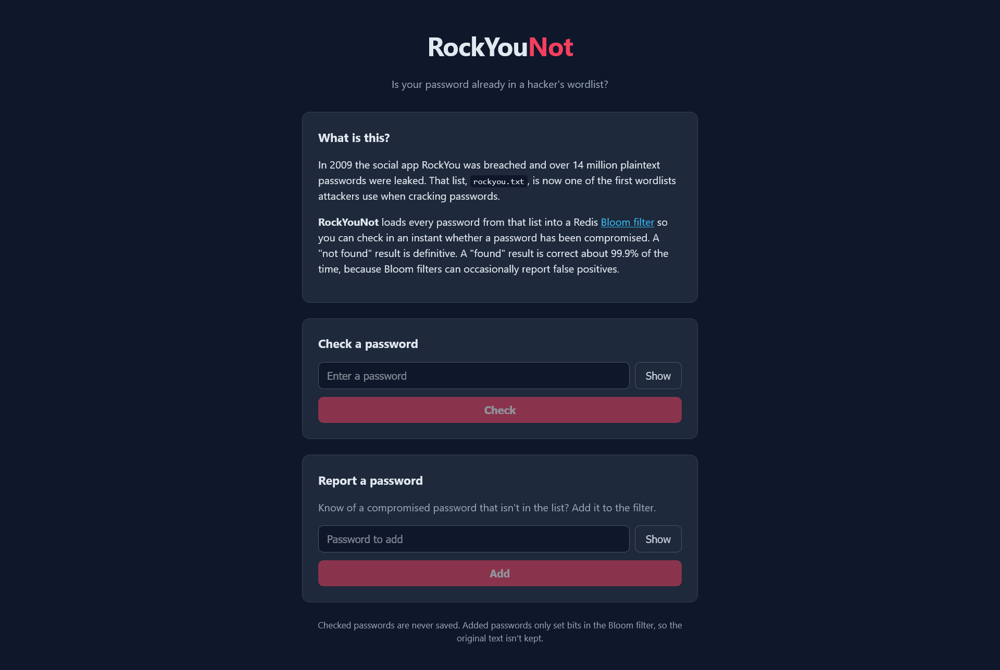

# RockYouNot

**Is your password already in a hacker's wordlist?**

RockYouNot checks passwords against the [RockYou](https://en.wikipedia.org/wiki/RockYou#Data_breach) breach list using a Redis [Bloom filter](https://en.wikipedia.org/wiki/Bloom_filter).



## What is this?

In 2009 the social app RockYou was breached and over 14 million plaintext passwords were leaked. That list, `rockyou.txt`, is now one of the first wordlists attackers try when cracking passwords.

At startup, RockYouNot loads every password from `rockyou.txt` into a Redis Bloom filter. After that, a lookup takes about the same time no matter how big the list is.

- A **"not found"** result is definitive: the password is not in the list.
- A **"found"** result is correct about 99.9% of the time. Bloom filters can return false positives, and the default error rate is `0.001`.

Users can also **report** a compromised password. It is added to the filter. Checked passwords are never stored. Added passwords only set bits in the filter, so the original text isn't kept.

## Tech stack

- **Go** (standard library `net/http`) for the HTTPS server and API
- **Redis** with Bloom filter support (`BF.RESERVE`, `BF.MADD`, `BF.EXISTS`) via [go-redis](https://github.com/redis/go-redis)
- **Alpine.js** with plain HTML and CSS for the frontend (`static/`)

## Project layout

```
cmd/                 HTTP server: config, routes, handlers
data/seed.go         Streams the wordlist into the store in chunks
internal/reader/     Chunked line reader backed by a sync.Pool
internal/stores/     PasswordStore interface + Redis Bloom filter implementation
static/              Frontend (index.html, app.js, styles.css)
docker-compose.yml   Local Redis
Makefile             Common tasks
```

## Getting started

### Prerequisites

- Go 1.27+
- Docker (for Redis)
- A copy of `rockyou.txt`

### 1. Get the wordlist

The server reads the wordlist from `data/rockyou.txt`. If you have the zipped copy at `data/rockyou.txt.zip`, extract it with:

```sh
make data
```

This only unzips when `data/rockyou.txt` doesn't exist yet, and it never overwrites an existing file. `make run` and `make build` run it automatically. `rockyou.txt` is git-ignored.

### 2. Start Redis

```sh
make up
```

The Bloom filter commands need Redis 8+ or Redis Stack. The `redis:alpine` image in `docker-compose.yml` should be Redis 8 or newer.

### 3. Generate a TLS certificate

The server only serves HTTPS and reads its certificate from `./tls/cert.pem` and `./tls/key.pem`. To create a self-signed certificate for local development:

```sh
mkdir -p tls && cd tls && go run "$(go env GOROOT)/src/crypto/tls/generate_cert.go" --rsa-bits 2048 --host localhost
```

### 4. Run

```sh
make run
```

The server seeds the filter from the wordlist (this can take a moment) and then listens on **https://localhost:5001**.

> **Warning:** Startup runs `FLUSHALL` on the configured Redis instance before creating the filter. Don't point it at a Redis that holds other data.

### Build a binary

```sh
make build
```

This builds `bin/rockyounot` and copies `tls/` and `data/*.txt` next to it. Run it from inside `bin/` so the relative paths (`./tls`, `./data`, `./static`) resolve. You'll also need `static/` there.

## Configuration

All settings are command-line flags:

| Flag         | Default              | Description                                 |
|--------------|----------------------|---------------------------------------------|
| `-addr`      | `5001`               | Port to listen on                           |
| `-redisAddr` | `localhost:6379`     | Redis address                               |
| `-seedFile`  | `./data/rockyou.txt` | Wordlist to seed into the filter            |
| `-capacity`  | `15000000`           | Bloom filter capacity to reserve            |
| `-errorRate` | `0.001`              | Target false-positive rate                  |
| `-chunkSize` | `1000`               | Passwords per batch when seeding (`BF.MADD`) |

Example:

```sh
go run ./cmd -redisAddr redis.local:6379 -errorRate 0.0001
```

### Filter sizing

With the default `-capacity` and `-errorRate`, the standard Bloom filter formulas give:

| Parameter | Meaning                  | Value                            |
|-----------|--------------------------|----------------------------------|
| `n`       | Items in the filter      | 15,000,000                       |
| `p`       | False-positive rate      | 0.001000025 (1 in 1,000)         |
| `m`       | Bits in the filter       | 215,663,814 (25.71 MiB)          |
| `k`       | Hash functions           | 10                               |

These come from:

```
m = ceil((n * log(p)) / log(1 / pow(2, log(2))))
k = round((m / n) * log(2))
p = pow(1 - exp(-k / (m / n)), k)
```

These are theoretical numbers. Redis picks its own internal layout, so actual memory use may differ slightly.

## API

### Check a password

```http
POST /passwords/check
Content-Type: application/json

{ "password": "iloveyou" }
```

Response `200 OK`:

```json
{ "exists": true }
```

### Report a password

```http
POST /passwords
Content-Type: application/json

{ "password": "some-leaked-password" }
```

Response `201 Created` with an empty body.

Both endpoints return `400 Bad Request` if the body is invalid or the password is empty.

```sh
curl -k -X POST https://localhost:5001/passwords/check \
  -H 'Content-Type: application/json' \
  -d '{"password":"123456"}'
```

## Make targets

| Target       | Description                                 |
|--------------|---------------------------------------------|
| `make up`    | Start Redis with Docker Compose             |
| `make down`  | Stop Redis                                  |
| `make data`  | Unzip `data/rockyou.txt.zip` if the `.txt` is missing |
| `make run`   | Run the server with `go run`                |
| `make build` | Build the binary into `bin/`                |
| `make certs` | Generate a self-signed certificate          |
